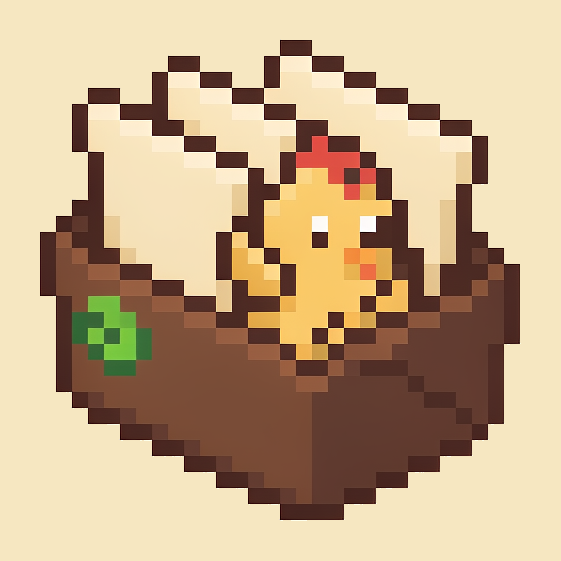

# SMMS

**Stardew Valley Mods Management System** — 星露谷物语模组管理器（Windows 桌面端）

面向模组玩家的环境管理工具：把「换一套玩法就要手工搬一遍 Mods 文件夹」变成「点一下切换配置档」。

<p align="center">
  
</p>

---

## 它解决什么问题

星露谷的模组都放在游戏根目录的 `Mods` 里，想同时维护「原版纯净」「轻度美化」「大型整合」几套环境，传统做法只能是反复剪切粘贴，稍有差池就丢配置、坏存档。

SMMS 把这件事拆成三层：

| 层 | 做什么 |
|---|---|
| **配置档** | 每套环境一个独立 `Mods` 目录，互不干扰；切换时只动符号链接与路径，不搬文件 |
| **模组** | 单个模组的启用/停用、依赖与冲突检测、备注、搜索排序 |
| **快照** | 任意时刻的完整环境留档，出问题整体回退 |

---

## 功能特性

### 配置档管理

- 多环境隔离：每个配置档拥有独立的 `Mods` 目录，或选择「完整实例隔离」（连存档一起隔离）
- **手动排序**：按使用习惯拖动顺序，原版与默认档固定前两位
- 一键切换、复制、导出/导入（仅清单或连同模组打包）
- 内置「原版」档：不带任何模组启动，用于验证「是不是模组的问题」

### 模组管理

- 启用 / 停用（重命名为 `.disabled`，不改文件内容）
- 依赖与冲突检测：缺失前置、版本不满足、唯一 ID 重复都会标出
- 自定义备注：给模组写中文说明，与作者简介视觉分层显示
- 搜索、按状态筛选、多种排序方式
- 中文翻译：内置 MyMemory / 百度翻译接入，可批量翻译模组简介

### 更新与安装

- 基于 [smapi.io](https://smapi.io) 的更新检查，联网比对已装版本
- 整包拖入安装：支持 zip / 7z，自动识别 `UniqueID` 而非文件夹名
- 覆盖式更新会**保留玩家自己的 `config.json`**，只替换程序文件
- 更新前自动创建快照，改坏了能整体退回

### 美化包管理

- 资源替换包（XNB 覆盖）：同一时间只生效一套，开关式切换
- Content Patcher 包：可多套共存，独立开关
- 两栏统一交互，不再出现「一边按钮一边开关」的割裂感

### 快照与回滚

四类快照，按触发方式区分保留策略：

| 类型 | 触发 | 保留 |
|---|---|---|
| 手动 | 点「立即备份」 | 永不自动清理 |
| 启动前 | 每次启动游戏前 | 始终只留最新一份 |
| 更新前 | 拖入新版本更新模组 | 最近 5 份 |
| 恢复前 | 执行回滚操作 | 最近 5 份 |

**增量存储**：内容未变的文件走 NTFS 硬链接，与上一份快照共享磁盘数据，不重复占空间。每个快照仍是完整目录树，恢复时不需要处理链式依赖。

### 其他

- SMAPI 检测与安装引导（版本比对、下载链接）
- 中英文界面切换
- 启动前预检：缺失依赖、冲突、SMAPI 版本不符都会在启动前提示

---

## 环境要求

| 项目 | 要求 |
|---|---|
| 操作系统 | Windows 10 / 11（x64） |
| 运行时 | .NET 10 运行时（[下载](https://dotnet.microsoft.com/download/dotnet/10.0)） |
| 游戏 | 星露谷物语（Steam / GOG 均可，启动时自动发现） |
| SMAPI | 建议已安装（默认配置档直接映射游戏 `Mods` 目录） |

---

## 下载与运行

1. 从 Releases 下载 `SMMS-x.y.z-win-x64.zip`
2. 解压到任意**独立目录**，例如 `D:\Games\SMMS`
   > ⚠️ 不要解压到游戏根目录——程序会在游戏目录下创建 `_smms` 工作区
3. 双击 `SMMS.Desktop.exe`
4. 首次启动会自动扫描 Steam / GOG 安装记录，无需手动填路径

---

## 从源码构建

```bash
git clone https://github.com/<your-name>/SMMS.git
cd SMMS

# 构建
dotnet build SMMS.slnx -c Release

# 跑测试
dotnet test SMMS.slnx

# 发布（框架依赖，体积小，需目标机装 .NET 10）
dotnet publish src/SMMS.Desktop/SMMS.Desktop.csproj \
  -c Release -r win-x64 --self-contained false -o publish/fd

# 发布（自包含，约 200 MB，免装运行时）
dotnet publish src/SMMS.Desktop/SMMS.Desktop.csproj \
  -c Release -r win-x64 --self-contained true -o publish/standalone
```

图标资源可由脚本重新生成（需要 Python + Pillow）：

```bash
python tools/make_icon.py           # 应用图标（像素小鸡 + 文件夹）
python tools/make_logo_assets.py    # 品牌 logo 抠图与 ICO 导出
```

---

## 项目结构

```
SMMS/
├── src/
│   ├── SMMS.Core/             领域模型、配置、扫描器（无外部依赖）
│   ├── SMMS.UseCases/         业务编排：配置档、模组、快照、导入、更新
│   ├── SMMS.Infrastructure/   平台实现：文件系统、Steam/GOG 定位、设置持久化
│   └── SMMS.Desktop/          Avalonia UI：视图、ViewModel、样式、i18n
├── tests/
│   ├── SMMS.Core.Tests/
│   └── SMMS.UseCases.Tests/   82 个单元测试
├── docs/                      设计文档与开发指南
├── assets/brand/              品牌图标源文件
├── tools/                     图标生成脚本
├── Directory.Build.props      统一版本号与编译选项
└── SMMS.slnx                  解决方案
```

依赖方向严格单向：`Desktop → UseCases → Core`，`Infrastructure` 只被 `Desktop` 在启动时装配。

---

## 文档

| 文档 | 内容 |
|---|---|
| [docs/01-技术决策](docs/01-技术决策.md) | 技术选型与架构取舍的来龙去脉 |
| [docs/02-实例与启动设计](docs/02-实例与启动设计.md) | 隔离实例、启动流程、打包分发设计 |
| [docs/03-功能说明](docs/03-功能说明.md) | 面向使用者的完整功能与操作说明 |
| [docs/04-开发指南](docs/04-开发指南.md) | 环境搭建、代码结构、测试与发布流程 |
| [docs/05-版本说明](docs/05-版本说明.md) | 版本历史与发布形态差异 |

---

## 数据存放位置

```
%APPDATA%\SMMS\
├── settings.json      配置档列表、游戏路径、激活档
└── logs\              运行日志（排查问题看这里）

<游戏目录>\_smms\
├── profiles\          各配置档独立的 Mods 目录
├── snapshots\         快照（回滚用）
└── mod-backup\        更新模组前的单模组备份
```

卸载时删除这两处即可完全清理。

---

## 已知限制

- 快照的硬链接增量仅在同一磁盘卷内生效，跨卷时自动退化为完整复制
- 框架依赖版本需要目标机预装 .NET 10 运行时
- 默认配置档直接映射游戏 `Mods` 目录，假定已安装 SMAPI
- 仅支持 Windows（文件系统与 Steam 定位逻辑依赖 Win32 API）
- 更新源仅使用 smapi.io，尚未接入 Nexus Mods API

---

## 许可

[MIT License](LICENSE)

---

<p align="right">设计与开发 · <b>Zero</b></p>
